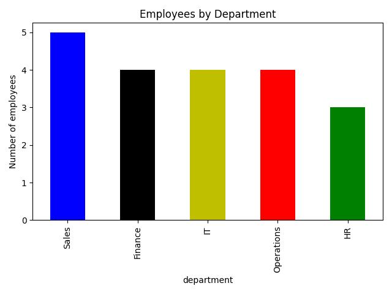

# Employee Attrition Analysis Using Python

## 1. Project Overview

This project explores employee data to understand workforce distribution and examine employee attrition patterns using Python.

The analysis focuses on employee departments, overtime, monthly income and attrition rates.

## 2. Project Objectives

- Inspect the employee dataset and check data quality.
- Calculate the overall employee attrition rate.
- Identify departments with higher attrition rates.
- Compare attrition between employees who work overtime and those who do not.
- Calculate average monthly income by department.
- Visualize employee distribution across departments.

## 3. Dataset Description

The dataset used is `05_employee_attrition.csv`.

Key variables include:
- Department
- Attrition
- Overtime
- Monthly income

## 4. Tools and Libraries

- Python
- Pandas – Data manipulation and analysis.
- NumPy – Numerical operations.
- Matplotlib – Data visualization.

## 5. Analysis Questions

1. How many employees are included in the dataset?
2. Are there missing values?
3. What is the overall employee attrition rate?
4. Which department has the highest attrition rate?
5. How does overtime relate to employee attrition?
6. What is the average monthly income by department?
7. How are employees distributed across departments?

## 6. Data Visualization

### Employees by Department

The bar chart illustrates the number of employees in each department.

## 7. Key Skills Demonstrated

- Data inspection and quality checks.
- Data aggregation using groupby().
- Filtering and conditional analysis.
- Calculating percentages and averages.
- Exploratory Data Analysis (EDA).
- Data visualization using Matplotlib.

## 8. Project Limitation

The dataset has a relatively small sample size, which may limit the reliability and generalisability of the findings. A larger dataset would provide a more representative picture of employee attrition patterns.

## 9. Conclusion

This project demonstrates how Python can be used to explore employee data, calculate attrition metrics, compare departments and communicate findings through visualizations.

It has strengthened my practical skills in data analysis using Pandas, NumPy and Matplotlib.

---

**Project Status:** Completed

**Author:** Patrick Njuguna

